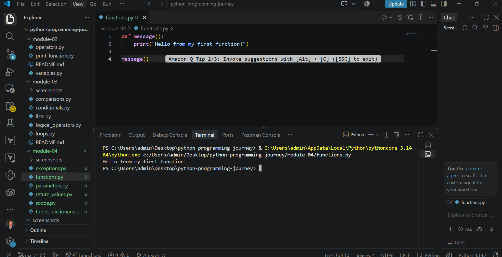
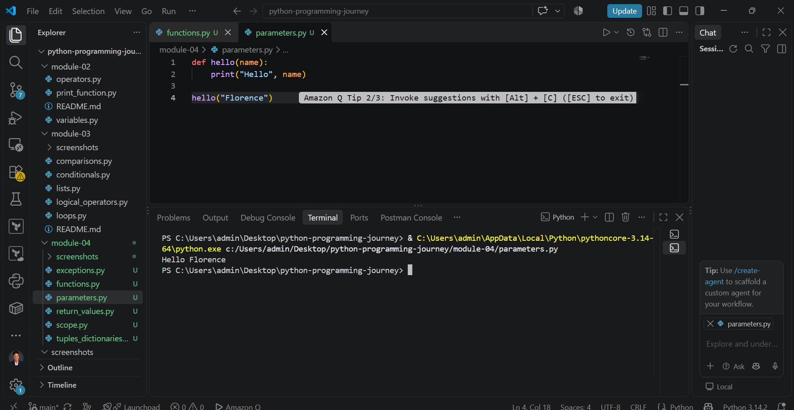
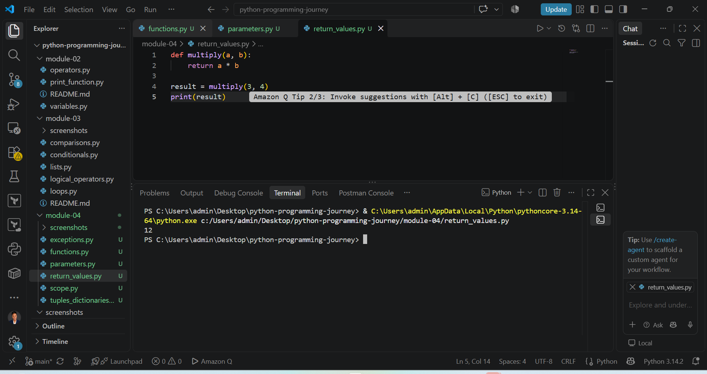
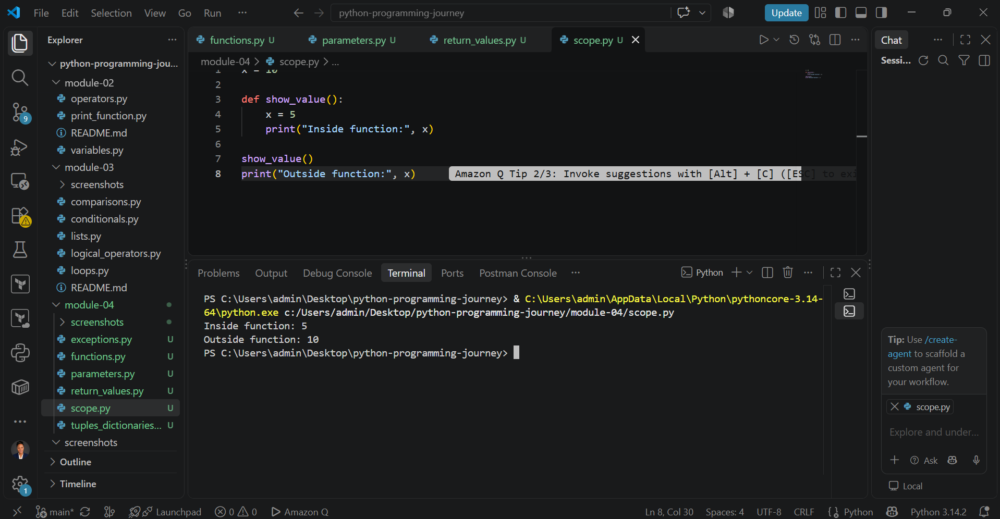
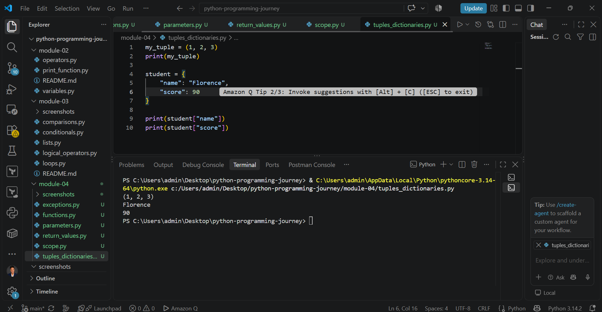
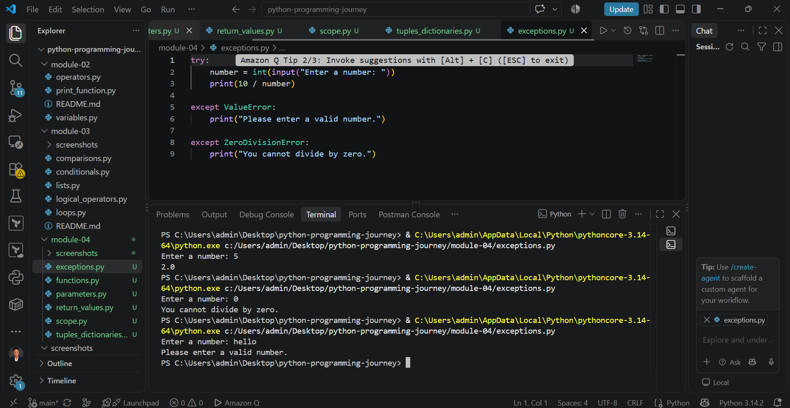

# Python Programming Journey - Week 4

## Overview

In Week 4, I learned how to make my Python programs more organised and reusable using functions.

I also practised parameters, return values, variable scope, tuples, dictionaries, and exception handling.

## What I Learned

### 1. Functions

I learned that a function is a reusable block of code created to perform a specific task.

```python
def message():
    print("Hello from my first function!")

message()
```

Functions help reduce repeated code and make programs easier to understand.

### 2. Parameters and Arguments

I learned how to pass information into a function using parameters.

```python
def hello(name):
    print("Hello", name)

hello("Florence")
```

Here, `name` is the parameter and `"Florence"` is the argument.

### 3. Return Values

I learned how the `return` statement sends a result back from a function.

```python
def multiply(a, b):
    return a * b

result = multiply(3, 4)
print(result)
```

The output was:

```text
12
```

### 4. Variable Scope

I practised the difference between variables created inside and outside a function.

```python
x = 10

def show_value():
    x = 5
    print("Inside function:", x)

show_value()
print("Outside function:", x)
```

The output showed:

```text
Inside function: 5
Outside function: 10
```

This helped me understand local and global scope.

### 5. Tuples and Dictionaries

I learned that tuples store multiple values but cannot be changed easily after creation.

```python
my_tuple = (1, 2, 3)
```

I also practised dictionaries, which store information using key-value pairs.

```python
student = {
    "name": "Florence",
    "score": 90
}
```

I accessed the values using:

```python
print(student["name"])
print(student["score"])
```

### 6. Exception Handling

I learned how to prevent a program from stopping unexpectedly by using `try` and `except`.

```python
try:
    number = int(input("Enter a number: "))
    print(10 / number)

except ValueError:
    print("Please enter a valid number.")

except ZeroDivisionError:
    print("You cannot divide by zero.")
```

I tested the program with:

- `5` and received `2.0`
- `0` and received `You cannot divide by zero.`
- `hello` and received `Please enter a valid number.`

This showed me how Python handles different types of errors.

## Hands-on Practice

During Week 4, I created and tested:

- `functions.py`
- `parameters.py`
- `return_values.py`
- `scope.py`
- `tuples_dictionaries.py`
- `exceptions.py`

I ran each program in VS Code and checked the results in the terminal.

## Screenshots

### Functions



### Parameters and Arguments



### Return Values



### Variable Scope



### Tuples and Dictionaries



### Exception Handling



## Commands Used

| Command | Purpose |
|---|---|
| `python functions.py` | Runs the functions program |
| `python parameters.py` | Runs the parameters program |
| `python return_values.py` | Runs the return values program |
| `python scope.py` | Runs the variable scope program |
| `python tuples_dictionaries.py` | Runs the tuples and dictionaries program |
| `python exceptions.py` | Runs the exception handling program |
| `git status` | Shows changes in the repository |
| `git add .` | Adds changes to Git staging |
| `git commit -m "message"` | Saves changes with a description |
| `git push` | Uploads committed work to GitHub |

## Challenge

One challenge this week was understanding the difference between local and global variables.

Testing the values inside and outside a function made the concept clearer.

Exception handling was also interesting because I could see how the same program responded differently to valid input, zero, and text input.

## Key Takeaways

My main takeaway from Week 4 is that functions make Python programs more organised and reusable.

I can now:

- Create and call functions
- Pass arguments into functions
- Return values from functions
- Understand basic variable scope
- Work with tuples and dictionaries
- Handle common errors using `try` and `except`

Week 4 helped me move from writing simple scripts to building more structured Python programs.

## Week 4 Status

Completed.