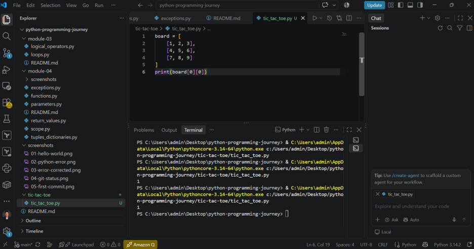
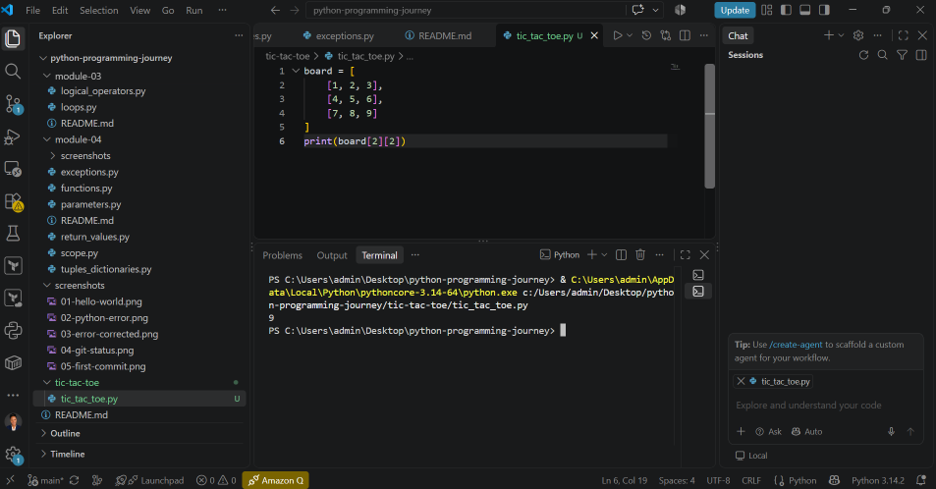
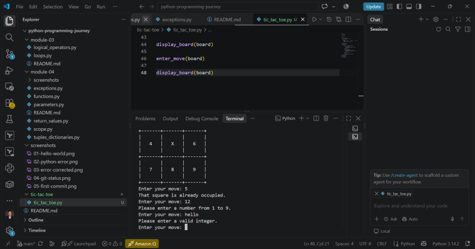
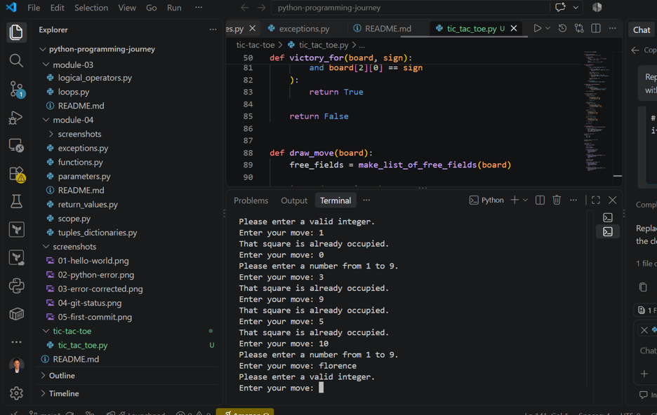
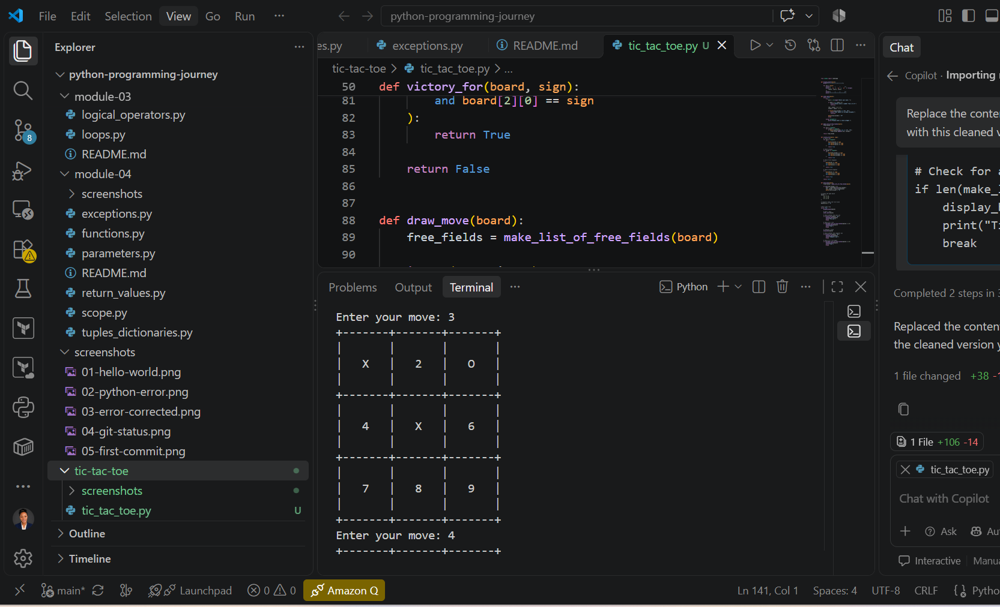
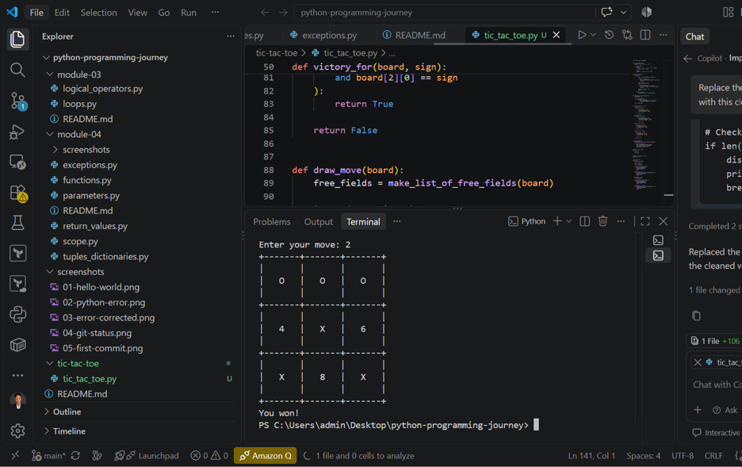

# Tic-Tac-Toe Python Project

## Project Overview

This project is a simple Tic-Tac-Toe game built with Python.

The computer plays using `X`, while the user plays using `O`.

The computer always makes the first move by placing `X` in the centre of the board. After that, the user and computer take turns until someone wins or the game ends in a tie.

## How the Game Works

The game board contains nine squares numbered from `1` to `9`.

```text
1 | 2 | 3
---------
4 | 5 | 6
---------
7 | 8 | 9
```

The user selects a square by entering its number.

The computer selects one of the available squares randomly.

## Concepts I Practised

During this project, I practised:

- Python functions
- Nested lists
- `if` statements
- `while` loops
- `for` loops
- User input
- Input validation
- Exception handling
- Tuples
- Random numbers
- List indexing
- Functions with parameters
- Returning values
- Game logic

## Main Functions

### `display_board()`

Displays the Tic-Tac-Toe board.

### `enter_move()`

Accepts the user's move and checks whether it is valid.

### `make_list_of_free_fields()`

Finds all available squares on the board.

### `victory_for()`

Checks whether the user or computer has won.

### `draw_move()`

Allows the computer to randomly select an available square.

## Board Structure

The board is stored using a nested list:

```python
board = [
    [1, 2, 3],
    [4, 5, 6],
    [7, 8, 9]
]
```

This allows each square to be accessed using:

```python
board[row][column]
```

## Computer's First Move

The computer always starts by placing `X` in the centre:

```python
board[1][1] = "X"
```

## User Input Validation

The program checks that the user's move:

- Is an integer
- Is between `1` and `9`
- Points to an available square

If the input is invalid, the user is asked to try again.

## Random Computer Move

The computer uses Python's `randrange()` function to randomly choose one of the available squares.

```python
from random import randrange
```

## Game Results

The game can end with:

```text
You won!
```

```text
Computer won!
```

or:

```text
Tie!
```

## Challenges

One challenge was converting the number entered by the user into the correct row and column of the nested list.

This was handled using:

```python
row = (move - 1) // 3
column = (move - 1) % 3
```

Another challenge was checking every possible winning combination across rows, columns, and diagonals.

Breaking the program into separate functions made the logic easier to understand and test.

## Screenshots

### Game Start



### User Move



### Invalid Move



### Occupied Square



### Computer Move



### Completed Game



## Key Takeaways

This project helped me understand how several Python concepts can work together to create a complete program.

My biggest lesson was that a larger programming problem becomes easier when it is divided into smaller functions.

I also learned how to validate user input, work with nested lists, handle errors, and control the flow of a program until a specific condition is reached.

## Project Status

✅ Completed

## Python Learning Journey

This project the final part of my Python learning journey under the Akwanya Hub Skill Pods Program.